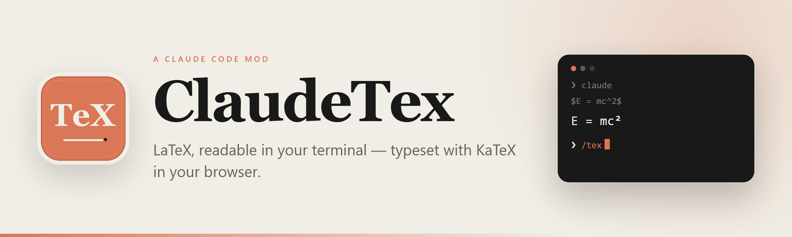
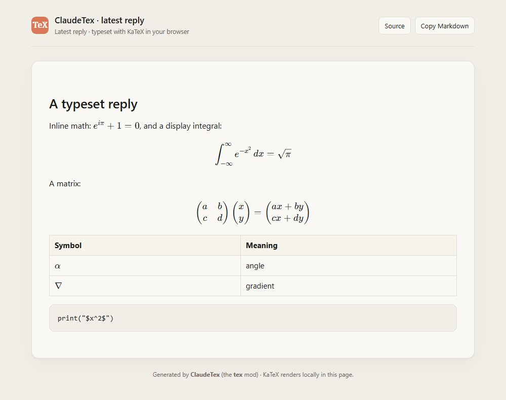

<p align="center">
  <picture>
    <source media="(prefers-color-scheme: dark)" srcset="docs/banner-dark.png">
    
  </picture>
</p>

<h1 align="center">ClaudeTex</h1>

<p align="center">
  <strong>LaTeX, readable in your terminal — typeset with KaTeX in your browser.</strong><br>
  A real Claude Code mod. No wrapper. No VS Code. No TeX install.
</p>

<p align="center">
  <a href="https://github.com/huiihao/ClaudeTex/releases"></a>
  <a href="https://github.com/huiihao/ClaudeTex/actions/workflows/test.yml"></a>
  
  
  <a href="LICENSE"></a>
</p>

<p align="center">
  <a href="#quick-start">Quick start</a> ·
  <a href="#features">Features</a> ·
  <a href="#configuration">Configuration</a> ·
  <a href="#how-it-works">How it works</a> ·
  <a href="#limitations">Limitations</a> ·
  <a href="README.zh-CN.md">简体中文</a>
</p>

---

## Why ClaudeTex?

Claude Code's CLI is a character grid. It does not typeset LaTeX, and most existing solutions depend on terminal graphics (kitty/Ghostty) that Windows Terminal does not support.

ClaudeTex is a **real Claude Code mod** that hooks the renderer itself. It gives you two complementary layers:

1. **In the terminal** — inline math becomes Unicode, and display math is laid out as a two-dimensional block: fractions with a real bar, roots, limits above and below sums, matrices, `cases`, `aligned`, `boxed`. Works in any terminal.
2. **In the browser** — `/tex` writes the current reply to a local HTML page and opens it with **KaTeX** for pixel-perfect typesetting. Complex formulas that are hard to read in a cell grid look exactly right there.

> **Design principle: never lose the reply.** If a formula is malformed, too large, or nested too deeply, ClaudeTex leaves the original LaTeX in place instead of breaking the session.

## Demo

```text
You  ❯  differentiate f(x) = x² sin x

●  f′(x) = 2x sin x + x² cos x

You  ❯  show the quadratic formula

        −b ± √(b² − 4ac)
        ────────────────
                   2a

You  ❯  /tex
   KaTeX preview opened in your browser: …/claudetex-preview-….html
```

<p align="center">
  <a href="docs/claudetex-intro.mp4"></a>
</p>

<p align="center"><sub><strong>10-second tour</strong> · click to watch the 1080p MP4</sub></p>

<p align="center">
  
</p>

<p align="center"><sub>The on-demand KaTeX preview, opened with <code>/tex</code>.</sub></p>

## Features

| | |
| --- | --- |
| **Automatic terminal typesetting** | `$...$` and `\(...\)` are converted before Claude Code draws the reply. |
| **Real 2D display math** | Fractions, roots, `\sum` / `\prod` limits, matrices, `cases`, `aligned`, `boxed`, `\binom`. |
| **True KaTeX on demand** | `/tex` opens the latest reply in your browser; `/tex all` includes every reply from the session. |
| **Markdown-aware** | Code fences and inline code are untouched. `$5`, `$10`, `$PATH`, `$and$` are not mistaken for math. |
| **Cross-platform** | Windows Terminal, macOS, Linux; terminal, Desktop app and VS Code extension surfaces. |
| **Zero runtime dependencies** | Runs inside Claude Code. No Node.js, no TeX distribution, no external process. |
| **Hardened by design** | Input limits, no-throw fallbacks, SRI-checked CDN assets, strict CSP and DOMPurify. |

## Quick start

### Install from GitHub

```bash
claude plugin marketplace add huiihao/ClaudeTex
claude plugin install tex@claudetex
```

Then open a new conversation and ask a math question. That's it.

> **Names:** the project and GitHub repository are **ClaudeTex**. The marketplace id is lowercase `claudetex`, the installable plugin id is `tex`, and the command is `/tex`. This keeps the internal ids DNS-safe while the brand stays readable.

### Local development

```bash
git clone https://github.com/huiihao/ClaudeTex
cd ClaudeTex
claude --plugin-dir .
```

### Requirements

- Claude Code **2.1.287+** (mods are enabled by default from that version; tested on 2.1.304).
- A terminal, the Desktop app's Code tab, or the VS Code extension.
- A browser and internet access for the `/tex` preview (assets are loaded from cdnjs with SRI).

## Usage

Just ask normally. ClaudeTex adds a short note to the first prompt of each context window so the model writes formulas as LaTeX.

```text
/tex          # latest reply containing math
/tex all      # every reply in this session
/tex-preview  # alias for /tex
```

The preview is written to the system temp directory and opened with your default browser. The command prints the file path, so you can open it manually if the browser does not launch.

After installing or editing the plugin in an already-running session, run `/reload-plugins` (or restart the session). New sessions load it automatically.

## Configuration

Run `/plugin configure tex@claudetex`, or edit `~/.claude/settings.json`:

```json
{
  "pluginConfigs": {
    "tex": {
      "options": {
        "inline": true,
        "display": true,
        "teach_claude": true,
        "max_width": 0
      }
    }
  }
}
```

| Option | Default | Description |
| --- | --- | --- |
| `inline` | `true` | Convert `$...$` and `\(...\)` to Unicode math. |
| `display` | `true` | Lay out `$$...$$` and `\[...\]` as two-dimensional blocks. |
| `teach_claude` | `true` | Tell the model to write LaTeX on the first prompt of each context window. |
| `max_width` | `0` | Maximum width of a display formula in terminal cells. `0` follows the terminal. |

## Supported LaTeX

<details>
<summary><strong>Symbols, scripts, fractions, environments, fonts and accents</strong></summary>

| Category | Examples |
| --- | --- |
| Greek and symbols | `\alpha \beta \pi \infty \partial \nabla \forall \exists` |
| Operators and relations | `\pm \times \cdot \le \ge \ne \approx \equiv \in \subset \cup \cap \to \Rightarrow` |
| Scripts | `x_i^2`, `\sum_{i=1}^n`, `\int_0^1` |
| Fractions and roots | `\frac{a+b}{c}`, `\dfrac`, `\sqrt{x}`, `\sqrt[3]{x}` |
| Large operators | `\sum \prod \int \iint \oint \bigcup \bigcap` |
| Environments | `pmatrix`, `bmatrix`, `Bmatrix`, `vmatrix`, `Vmatrix`, `cases`, `aligned`, `align`, `gather`, `multline` |
| Fonts | `\mathbb`, `\mathcal`, `\mathfrak`, `\mathbf`, `\boldsymbol`, `\mathsf`, `\mathtt`, `\mathit`, `\mathrm` |
| Accents | `\hat`, `\bar`, `\vec`, `\dot`, `\ddot`, `\tilde`, `\overline`, `\underline` |
| Utilities | `\text{...}`, `\boxed{...}`, `\binom{n}{k}`, `\operatorname{...}`, `\left( ... \right)`, `\not\in` |

</details>

## How it works

ClaudeTex is a standard Claude Code **mod**: a plugin whose hooks module registers functions that run inside Claude Code's own process.

```text
ClaudeTex/
├── .claude-plugin/
│   ├── plugin.json          # manifest + user config
│   ├── marketplace.json     # marketplace manifest
│   └── icon.png
├── hooks/
│   ├── hooks.json
│   └── register.ts          # ui.render / prompt.submit / command.run
├── src/
│   ├── tex/
│   │   ├── symbols.ts       # TeX tables, fonts, script maps
│   │   ├── parser.ts        # recursive-descent parser + limits
│   │   ├── layout.ts        # Unicode inline + 2D block layout
│   │   └── markdown.ts      # code-aware Markdown scanner
│   └── preview.ts           # KaTeX HTML page (SRI + CSP)
├── tests/                   # 38 tests
├── docs/
│   ├── banner-light.png
│   ├── banner-dark.png
│   ├── icon.png
│   └── preview.png
└── README.md
```

| Hook / API call | Role |
| --- | --- |
| `ui.render` (`AssistantMessage`) | Rewrites the reply before drawing: inline math to Unicode, display math to a 2D block. |
| `ui.render` (`CommandOutput`) | Same treatment for command output such as `/btw` answers. |
| `prompt.submit` | Adds a short “write math in LaTeX” note once per context window. |
| `session.start` | Registers `/tex` and `/tex-preview`. |
| `session.compact` / `session.end` | Resets the note after compaction or `/clear`. |
| `command.run` | `/tex`: reads `$.session.messages()`, writes the HTML with `$.fs.write`, opens it with `$.process.run`. |

Everything is local. Parsing, layout and HTML generation happen in the hooks module; there is no external process or npm runtime dependency.

## Robustness

The renderer is built to degrade gracefully rather than break a conversation:

- **Bounded parsing** — formulas longer than 8,000 characters or nested deeper than 64 levels are left as LaTeX. The parser guarantees forward progress, so malformed `\frac{`, unclosed `\begin{matrix}` and stray `}` cannot loop.
- **Bounded layout** — display blocks over 200 lines or 1,000 columns fall back to wrapped text. Long words are split by cell width.
- **Bounded scanning** — replies over 200,000 characters pass through untouched; code spans close only on an exact backtick run; CRLF is normalized.
- **Conservative math detection** — currency, shell variables, prose words and empty `$$ $$` are not rewritten. Explicit `\(...\)` and `\[...\]` may contain surrounding whitespace.
- **No-throw fallbacks** — every transform is wrapped; a failure returns the original reply.
- **Preview hardening** — SRI on every CDN script and stylesheet, a strict CSP (`connect-src 'none'`), DOMPurify cleaning, and the Markdown source stored in an inert `<template>`.
- **Tested** — 38 tests cover malformed input, deep nesting, oversized replies, CRLF, code spans, currency heuristics, command failures and command registration.

## Limitations

<details>
<summary><strong>What ClaudeTex deliberately does not do</strong></summary>

- **The terminal is not pixel-perfect KaTeX.** It is a character grid; fractions and matrices are Unicode approximations. Use `/tex` for real typesetting.
- **No terminal images.** Windows Terminal does not support the kitty graphics protocol, and Claude Code's `Image` element is limited to kitty/Ghostty-class terminals.
- **Inline math is heuristic.** Rare currency, URL or shell-variable cases can be misdetected. Wrap them in backticks to opt out.
- **Indented code blocks (4 spaces)** may still have `$...$` transformed. Use fenced code blocks for code.
- **Not a full TeX engine.** Exotic macros, TikZ and external packages are out of scope; unknown commands are shown by name.
- **`/btw` panels** are drawn outside `ui.render`; ClaudeTex asks the model to use Unicode math there.
- **The preview needs a network** to load KaTeX, marked and DOMPurify from cdnjs. Offline, it falls back to the Markdown source.

</details>

## Development

```bash
claude plugin validate .
claude plugin test
npx -y -p typescript@5.7 tsc -p tsconfig.check.json
npx -y -p typescript@5.7 tsc -p tsconfig.real.json   # after loading once with --plugin-dir
```

`claude --plugin-dir .` writes the exact mod types for your Claude Code version into `.claude-plugin/types/` (ignored by Git).

## Privacy

- ClaudeTex itself makes no network requests. Parsing, layout and HTML generation are local.
- The `/tex` page loads KaTeX, marked and DOMPurify from `cdnjs.cloudflare.com`, pinned with SRI. The reply content stays in your browser.
- Markdown is sanitized with DOMPurify before it is inserted into the page.
- Preview files are written to the system temp directory.

## Naming

**ClaudeTex = Claude + TeX.** The name `claudex` was considered, but it is already crowded on GitHub (mostly Claude + Codex multi-model proxies) and taken on npm. `claudetex` is available on npm, unambiguous, and keeps the TeX lineage visible.

## Acknowledgements

- [KaTeX](https://katex.org/) for browser typesetting.
- [marked](https://marked.js.org/) and [DOMPurify](https://github.com/cure53/DOMPurify) for the preview page.
- Claude Code's [mods API](https://code.claude.com/docs/en/plugins/mods/overview) for making a real in-process plugin possible.

## License

MIT — see [LICENSE](LICENSE).

---

<p align="center">
  <sub>ClaudeTex is an independent community project, not affiliated with Anthropic. Claude is a trademark of Anthropic, PBC.</sub>
</p>
